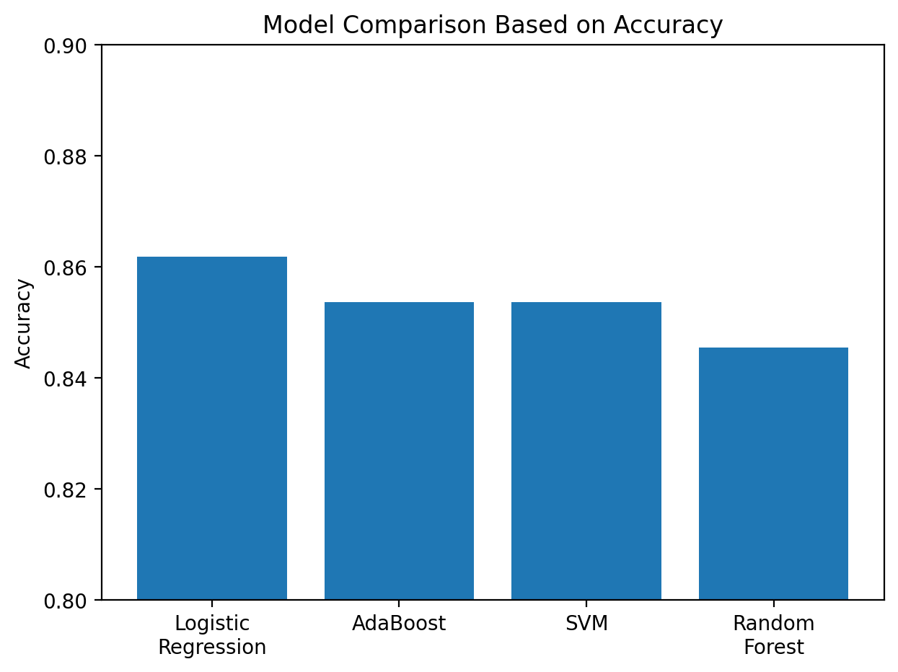
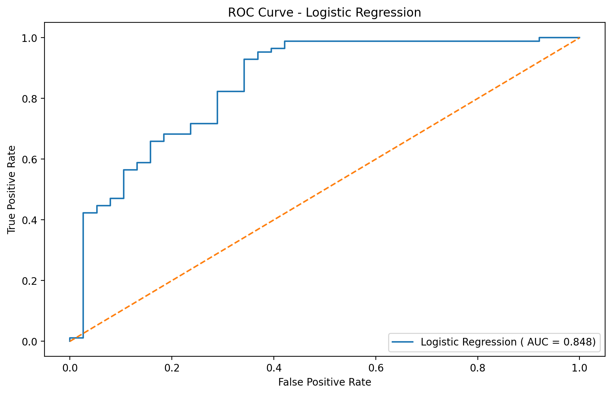
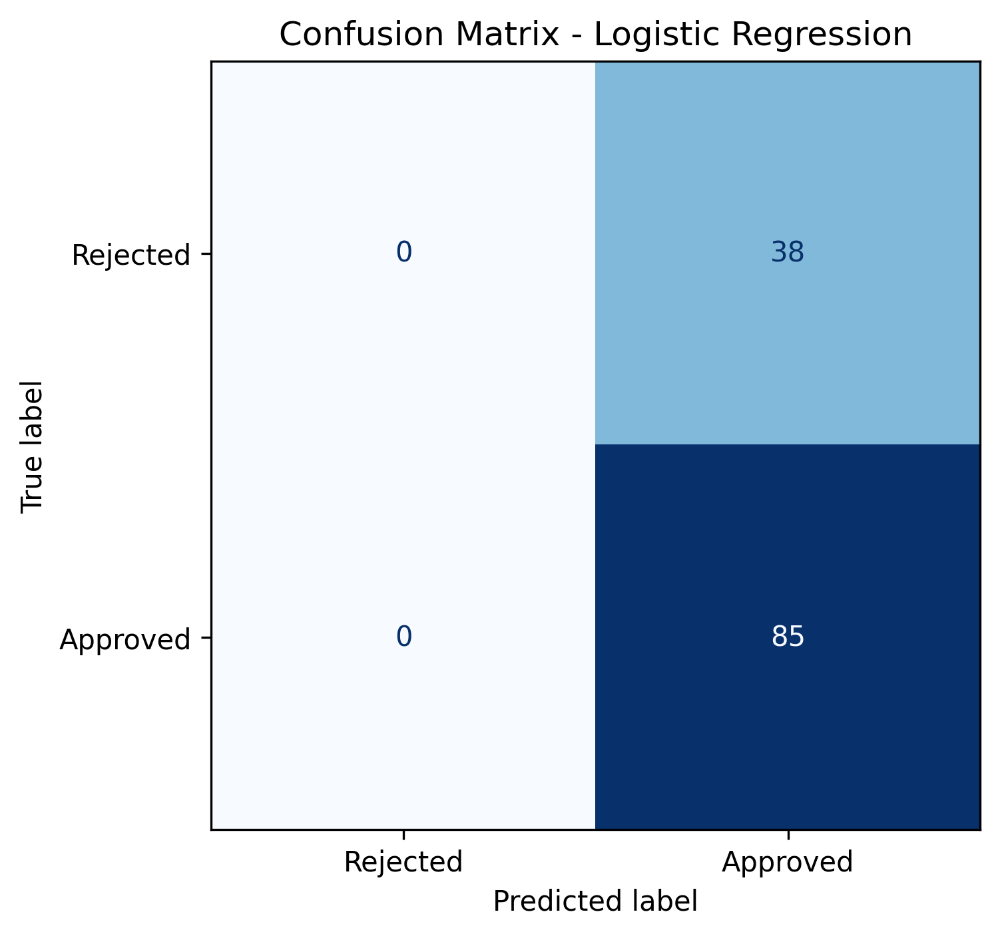
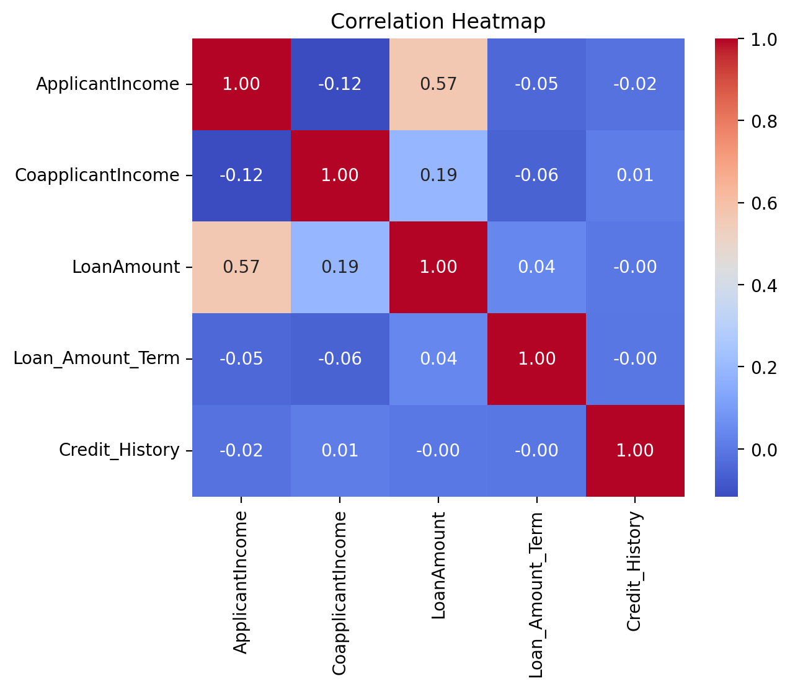

# 🏦 CrediScope AI &mdash; Loan Approval Prediction & Decision Engine


---

## 📌 Executive Summary

**CrediScope AI** is a production-grade Full-Stack Machine Learning application designed for retail banking and financial institutions to automate and de-risk loan eligibility decisioning. 

Built with an enterprise architecture, the platform couples a high-performance **FastAPI** inference backend with a responsive **React 18** FinTech user interface. The prediction engine evaluates multi-dimensional credit profiles against a tuned **Scikit-Learn Logistic Regression Pipeline** trained on retail credit datasets, delivering instant approval decisions alongside rigorous confidence and default-risk probability metrics.

---

## 🏗️ Architecture & Prediction Flow

```
┌────────────────────────────────────────────────────────┐
│                   React 18 Frontend                    │
│      (Vite + Component Architecture + Axios Client)    │
└──────────────────────────┬─────────────────────────────┘
                           │ POST /predict
                           ▼
┌────────────────────────────────────────────────────────┐
│                   FastAPI Backend                      │
│        (Pydantic Validation + CORS Middleware)         │
└──────────────────────────┬─────────────────────────────┘
                           │
                           ▼
┌────────────────────────────────────────────────────────┐
│                  ML Service Pipeline                   │
│  1. Preprocessing & One-Hot Encoding                   │
│  2. Exact 12-Feature Alignment                         │
│  3. StandardScaler Transformation                      │
│  4. Tuned Logistic Regression Classifier               │
└──────────────────────────┬─────────────────────────────┘
                           │
                           ▼
┌────────────────────────────────────────────────────────┐
│                  Response Payload                      │
│  • Decision (Approved / Not Approved)                  │
│  • Confidence Score (e.g., 85.74%)                     │
│  • Probability Distributions (Approval vs Rejection)   │
│  • Risk Factor Explanations                            │
└────────────────────────────────────────────────────────┘
```

---

## 🚀 Key Features

- **End-to-End Automated Pipeline:** Unifies data validation, encoding, standard scaling, and probability classification.
- **Strict ML Integrity:** Preserves original model artifacts (`loan_logistic_model.pkl` and `scaler.pkl`) with 100% feature-order fidelity.
- **Enterprise REST API:** Built with FastAPI, Pydantic v2 schemas, CORS security, health diagnostics (`/health`), and model metadata (`/model-info`).
- **Interactive FinTech UI:** Modern React interface featuring quick-test presets (Prime Applicant, Credit Risk, High Earner), client-side validation, loading spinners, and animated result indicators.
- **Probabilistic Risk Scoring:** Calculates real approval and rejection likelihoods using `predict_proba`.
- **Fault-Tolerant & Dockerized:** Graceful degradation on missing assets, user-friendly error banners, and production Docker containerization.

---

## 🤖 Machine Learning Model & Evaluation

The model was selected through empirical benchmarking across 8 candidate classification algorithms in `notebooks/Classification.ipynb`. The final estimator is a **Logistic Regression** pipeline tuned via **RandomizedSearchCV** (`liblinear` solver, `C=0.1`, `penalty='l2'`).

### Performance Benchmark

| Metric | Score | Significance |
| :--- | :--- | :--- |
| **Accuracy** | **86.18%** | Overall correct classifications across validation set |
| **Precision** | **84.00%** | Reliability when classifying an applicant as Approved |
| **Recall** | **98.82%** | Minimizes false rejections of eligible borrowers |
| **ROC-AUC** | **0.8483** | High discriminative capability between approval and default risks |

### Visual Validation Artifacts

| Model Comparison | ROC Curve |
| :---: | :---: |
|  |  |
| **Confusion Matrix** | **Correlation Heatmap** |
|  |  |

---

## 📊 Feature Dictionary & Preprocessing

The model requires an exact 12-dimensional feature vector in the following sequence:

| Index | Feature Name | Source Input | Encoding / Transformation | Value Space |
| :--- | :--- | :--- | :--- | :--- |
| 1 | `Dependents` | `dependents` | Ordinal Map (`'3+'` $\to$ 3) | `0, 1, 2, 3` |
| 2 | `ApplicantIncome` | `applicant_income` | Raw Numeric (INR / ₹) | $\ge 0$ |
| 3 | `CoapplicantIncome` | `coapplicant_income`| Raw Numeric (INR / ₹) | $\ge 0$ |
| 4 | `LoanAmount` | `loan_amount` | Numeric in ₹ Thousands (e.g., 120 = ₹1.2 Lakhs) | $> 0$ |
| 5 | `Loan_Amount_Term` | `loan_amount_term` | Term in months | Standard: `12` to `480` |
| 6 | `Credit_History` | `credit_history` | Binary Record Score | `1.0` (Good) or `0.0` (Poor) |
| 7 | `Gender_Male` | `gender` | One-Hot (Female dropped) | `1` (Male), `0` (Female) |
| 8 | `Married_Yes` | `married` | One-Hot (No dropped) | `1` (Yes), `0` (No) |
| 9 | `Education_Not Graduate` | `education` | One-Hot (Graduate dropped)| `1` (Not Graduate), `0` (Graduate) |
| 10 | `Self_Employed_Yes` | `self_employed` | One-Hot (No dropped) | `1` (Yes), `0` (No) |
| 11 | `Property_Area_Semiurban`| `property_area` | One-Hot (Rural dropped) | `1` (Semiurban), `0` (Other) |
| 12 | `Property_Area_Urban` | `property_area` | One-Hot (Rural dropped) | `1` (Urban), `0` (Other) |

*(Note: When `Property_Area` is Rural, both `Semiurban` and `Urban` dummy flags evaluate to `0`.)*

All 12 features are transformed via `StandardScaler` prior to classifier evaluation.

---

## 📂 Repository Structure

```
Loan-Approval-Prediction/
├── backend/
│   ├── app.py                      # FastAPI application entrypoint & routing
│   ├── Dockerfile                  # Production container definition
│   ├── requirements.txt            # Python backend dependencies
│   ├── .env.example                # Backend environment template
│   ├── models/
│   │   ├── loan_logistic_model.pkl # Trained Scikit-Learn Pipeline
│   │   └── scaler.pkl              # Fitted StandardScaler artifact
│   ├── data/
│   │   └── Loan_data.csv           # Source training dataset (614 rows)
│   ├── schemas/
│   │   ├── __init__.py
│   │   └── prediction_schema.py    # Pydantic v2 validation contracts
│   ├── services/
│   │   ├── __init__.py
│   │   └── prediction_service.py   # Preprocessing & inference pipeline
│   └── utils/
│       ├── __init__.py
│       └── logger.py               # Structured logging utility
│
├── frontend/
│   ├── package.json                # React & Vite dependencies
│   ├── vite.config.js              # Vite server & proxy configuration
│   ├── index.html                  # HTML5 application shell
│   ├── .env.example                # Frontend environment template
│   ├── public/
│   │   ├── favicon.svg             # FinTech brand SVG favicon
│   │   └── images/                 # Static charts for visual EDA tab
│   └── src/
│       ├── App.jsx                 # Tab navigation & health polling
│       ├── main.jsx                # React root bootstrap
│       ├── index.css               # Design system & FinTech responsive styles
│       ├── components/
│       │   ├── Header.jsx          # Top brand bar with live server status pill
│       │   ├── Footer.jsx          # Institutional copyright & stack details
│       │   ├── LoanForm.jsx        # Multi-section input form with presets & validation
│       │   ├── ResultCard.jsx      # Animated decision badge & probability meter
│       │   ├── ModelInfoCard.jsx   # Metrics KPI grid & visual EDA gallery
│       │   └── StatusBanner.jsx    # System notifications & error alerts
│       ├── pages/
│       │   └── DashboardPage.jsx   # Core decision workbench layout
│       └── services/
│           └── api.js              # Axios HTTP client with friendly error mapping
│
├── notebooks/
│   └── Classification.ipynb        # Original exploratory & model training notebook
│
├── images/                         # Validation charts & performance plots
│   ├── confusion_matrix_log.png
│   ├── correlation_heatmap.png
│   ├── model_comparison.png
│   └── roc_curve_logistic_regression.png
│
├── .gitignore                      # Git ignore rules (protects models & hides envs)
├── .env.example                    # Global environment configuration
└── README.md                       # Comprehensive system documentation
```

---

## ⚡ Quick Start Guide

### Prerequisites
- **Python:** 3.10, 3.11, 3.12, or 3.13
- **Node.js:** v18+ or v20+ with `npm`

---

### 1. Backend Setup

Open a terminal in the project root:

```bash
cd backend

# Create virtual environment (optional but recommended)
python -m venv venv

# Activate virtual environment
# Windows:
venv\Scripts\activate
# Linux/macOS:
source venv/bin/activate

# Install dependencies
pip install -r requirements.txt

# Start FastAPI server
uvicorn app:app --reload --host 127.0.0.1 --port 8000
```

Backend will be accessible at:
- **API Base:** [http://127.0.0.1:8000](http://127.0.0.1:8000)
- **Interactive Swagger Docs:** [http://127.0.0.1:8000/docs](http://127.0.0.1:8000/docs)
- **Health Check:** [http://127.0.0.1:8000/health](http://127.0.0.1:8000/health)

---

### 2. Frontend Setup

Open a second terminal in the project root:

```bash
cd frontend

# Install npm packages
npm install

# Start Vite development server
npm run dev
```

Frontend application will open at:
- **Web UI:** [http://localhost:5173](http://localhost:5173)

---

## 🔌 API Reference

### 1. Health Status
`GET /health`

**Response:**
```json
{
  "status": "healthy",
  "model_loaded": true,
  "scaler_loaded": true,
  "service": "Loan Approval ML Service"
}
```

### 2. Model Information
`GET /model-info`

**Response:**
```json
{
  "model_name": "Loan Approval Classifier",
  "model_type": "Binary Classification",
  "algorithm": "Logistic Regression (Tuned via RandomizedSearchCV)",
  "scaling": "StandardScaler (12 features)",
  "feature_count": 12,
  "features_expected": [
    "Dependents", "ApplicantIncome", "CoapplicantIncome", "LoanAmount",
    "Loan_Amount_Term", "Credit_History", "Gender_Male", "Married_Yes",
    "Education_Not Graduate", "Self_Employed_Yes", "Property_Area_Semiurban",
    "Property_Area_Urban"
  ],
  "performance_metrics": {
    "accuracy": "86.18%",
    "precision": "84.00%",
    "recall": "98.82%",
    "roc_auc": "0.8483"
  },
  "status": "ready"
}
```

### 3. Predict Loan Approval
`POST /predict`

**Request Body (JSON):**
```json
{
  "gender": "Male",
  "married": "Yes",
  "dependents": "1",
  "education": "Graduate",
  "self_employed": "No",
  "applicant_income": 5000.0,
  "coapplicant_income": 1500.0,
  "loan_amount": 120.0,
  "loan_amount_term": 360.0,
  "credit_history": 1.0,
  "property_area": "Semiurban"
}
```

**Response (HTTP 200 OK):**
```json
{
  "success": true,
  "prediction": 1,
  "loan_status": "Approved",
  "confidence": 0.8574,
  "approval_probability": 0.8574,
  "rejection_probability": 0.1426,
  "message": "Loan Application is Approved with an estimated confidence of 85.7%. Applicant financial indicators and credit history meet risk parameters."
}
```

*(Legacy payloads with pre-encoded binary flags like `Gender_Male`, `Married_Yes`, etc. are also accepted seamlessly for full backward compatibility).*

---

## 🧪 Testing & Verification

Automated validation verified:

1. **API Endpoints:**
   - `GET /` $\to$ `200 OK`
   - `GET /health` $\to$ `200 OK` (checks model and scaler memory load)
   - `GET /model-info` $\to$ `200 OK` (exposes safe model metadata)
2. **Inference Verifications:**
   - Prime applicant test case: Correctly predicted `Approved` with `85.74%` approval probability.
   - Credit-risk profile (poor credit score): Correctly predicted `Not Approved` with `94.29%` rejection probability.
   - Legacy compatibility test: Original `app.py` payload syntax verified.
3. **Data Validation:**
   - Negative income and malformed values return structured `422 Unprocessable Entity` responses without server crashes.
4. **CORS:**
   - Configured with explicit `Origin: http://localhost:5173` allowance.

---

## 🛡️ Financial Disclaimer

> **Notice:** This application and its underlying machine learning models are provided for informational, screening, and decision-support purposes only. They do not constitute formal financial, credit, or legal advice. Final underwriting decisions remain subject to regulatory standards, institutional compliance, and credit policy review.

---

## 👨‍💻 Original Author & Acknowledgements

- **Original ML Implementation & Dataset Research:** Dharani Kaligi
- **Full-Stack Enterprise Architecture & Production Pipeline:** AI/ML & Full-Stack Engineering Team
